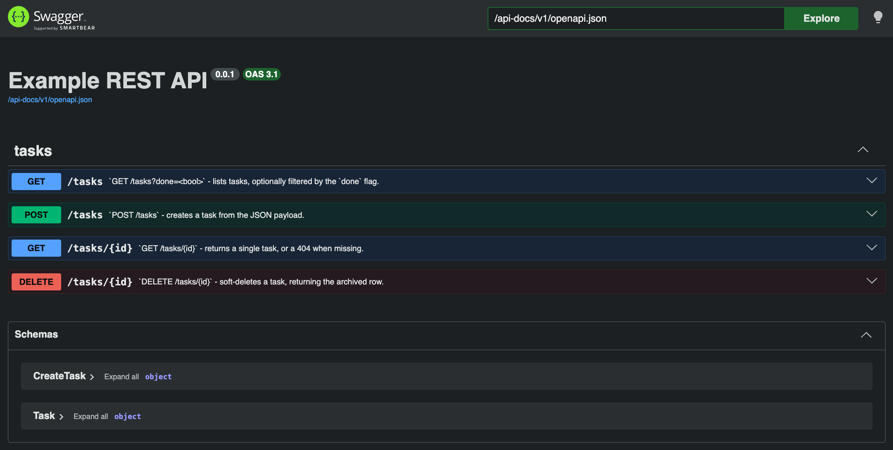

# Rust REST API example

Complete REST API example project in Rust with full OpenApi spec and tests. It uses dockerization (docker compose) for quick connection and database setup.



```sh
# copy variables example and adjust
cp .env.example .env

# start infra
docker compose up -d

# build project and dependencies
cargo build

# and run project (in development)
SERVER_ENVIRONMENT=develop cargo run
```

> [!TIP]
> If `SERVER_ENVIRONMENT=develop` it will automatically load environment variables from `.env` file.

## Prerequisites

- Docker with `docker compose`
- Rust toolchain (edition 2024, requires 1.85+)
- A `.env` file (see quick start) — a reachable Postgres is required at startup, migrations are applied automatically

Once running:

- Swagger UI: <http://localhost:8000/swagger-ui>
- Raw OpenAPI spec: <http://localhost:8000/api-docs/v1/openapi.json>
- pgAdmin: <http://localhost:15433>
- The API itself (example): <http://localhost:8000/tasks>

## Development

1.  Start server (with migrations)

    ```sh
    # build and run project (in development)
    SERVER_ENVIRONMENT=develop cargo run
    ```

2.  Fill db with init seed

    ```sh
    ./scripts/seed.sh
    ```

3.  Delete database (reset)

    ```sh
    docker compose exec -T database psql -U admin -d postgres \
        -c "DROP DATABASE IF EXISTS rust_rest_api WITH (FORCE);" \
        -c "CREATE DATABASE rust_rest_api;"
    ```

    > Adjust `-U admin` and `rust_rest_api` to your `POSTGRES_USER` / `POSTGRES_DB` values from `.env` if you changed them.

### Testing

Test API locally against local database. Before running, apply migrations (start the server once, step 1 above) and seed the database with the sample seed (step 2).

```sh
SERVER_ENVIRONMENT=develop cargo test
```
